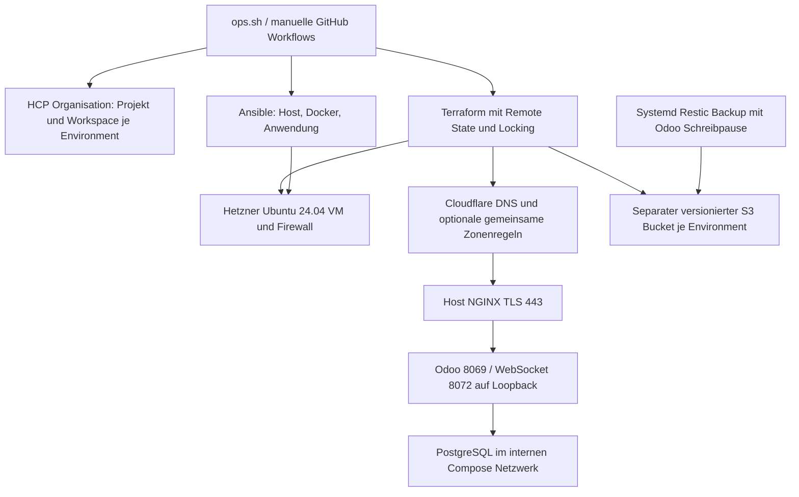

# Zielarchitektur

Jedes Environment hat genau eine VM, IP, Domain, Firewall, Compose-Projekt, Datenbank, lokale Daten, Secrets, Bucket, HCP-Workspace und GitHub-Environment. Die HCP-Organisation ist der bestehende Account-/Abrechnungscontainer, das Projekt die Berechtigungsgruppe und der Workspace der State-/Locking-Container. Cloud-Compute, DNS/Edge und State-Backend sind unabhängige Adapter.

NGINX läuft auf dem Host. Odoo/PostgreSQL laufen ohne privilegierte Container; nur NGINX ist öffentlich über 443 erreichbar. Keine Hostports für PostgreSQL. DNS-01-Zertifikate benötigen Port 80 nicht. Das dedizierte interne Datenbanknetz und das zusätzliche Odoo-Egress-Netz ermöglichen SMTP/HTTP nach außen ohne Datenbankfreigabe.

CPX12: 1 vCPU, 2 GB RAM, 40 GB Disk laut [Hetzner](https://docs.hetzner.cloud/whats-new). Standard: ein HTTP-Worker, ein Cron-Thread und Gevent, DB shared_buffers=128 MB, 50 Verbindungen. Containergrenzen: 1100 MB Odoo, 384 MB PostgreSQL; Rest bleibt Host/Proxy und Backup. Das ist ein kleines Betriebsprofil, keine garantierte Kapazitätszusage. Auf parallele Berichte, große Importe und Backup-Spitzen testen; bei OOM/CPU-Sättigung auf größere VM umstellen. Speichergrenzen sind Schutz, kein Leistungsnachweis.

Die VM ist ein Single Point of Failure. Native Hetzner-VM-Backups sind zusätzliche kostenpflichtige Server-Backups; konsistente Odoo-Sicherungen sind ausschließlich die Restic-Snapshots. S3 benötigt zusätzliche Kapazität für Versionen und unkompaktierte Packs. Für große Datenbestände ist CPX12 ungeeignet.
